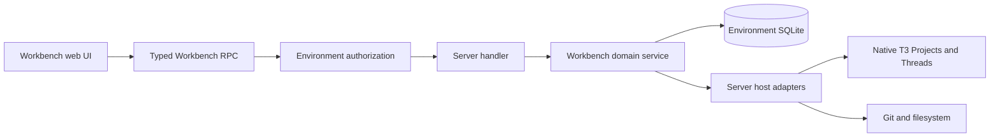

# Workbench architecture

Workbench is a planning layer inside a T3 Code environment. It owns Boards, Tickets, repository scope, Ticket worktrees, Assignments, and References. T3 Code remains the owner of Projects, Threads, provider execution, Git, and checkpoints. Workbench records refer to native Project and Thread IDs instead of copying those records. A Board and its records belong to one environment; its repositories and Threads may live on another (see [Repositories on another environment](#repositories-on-another-environment)).

## Module boundaries

| Layer                                                                   | Responsibility                                                                                                                                                   |
| ----------------------------------------------------------------------- | ---------------------------------------------------------------------------------------------------------------------------------------------------------------- |
| [Workbench contract modules](../../packages/contracts/src/workbench.ts) | Wire schemas for Workbench records, snapshots, and RPC inputs and results.                                                                                       |
| [`packages/workbench`](../../packages/workbench)                        | Domain rules, Workbench persistence and schema, and Ticket Workspace rules. It depends on interfaces for host capabilities and does not import application code. |
| [`apps/server/src/workbench`](../../apps/server/src/workbench)          | Environment-specific adapters for native records, Git, and configuration; service composition, reactors, RPC handlers, and authorization.                        |
| [`apps/web/src/workbench`](../../apps/web/src/workbench)                | React UI and environment-scoped queries and commands. Desktop uses this web UI inside Electron.                                                                  |

The product UI says **Board** to distinguish it from a native T3 Project. Existing `WorkbenchProject` types, RPC names, and `workbench_projects` storage names retain the older term for compatibility. [Contracts](../../packages/contracts/src/workbench.ts) and [schema](../../packages/workbench/src/WorkbenchSchema.ts) use those names.

## Request and ownership flow

The UI selects an environment before issuing commands. The server checks the Workbench RPC's environment scope, then passes the request to a composed Workbench service. Domain code owns the rule. Server adapters supply environment-specific native reads and effects and configuration. The Workbench page also reads native Project state through the existing T3 client path. [Web state](../../apps/web/src/workbench/state.ts), [RPC authorization](../../apps/server/src/workbench/rpcAuthorization.ts), [handlers](../../apps/server/src/workbench/workbenchRpcHandlers.ts), and [service composition](../../apps/server/src/workbench/serverLayer.ts) show the path.

Agents reach Workbench through the [MCP toolkit](../../apps/server/src/workbench/mcp/tools.ts), which the upstream MCP server registers with one line. A tool acts only on the calling Thread's own Ticket, through its active Assignment, or on the writable draft that the Thread plans. Tools take no owner ID, so an agent cannot address another Ticket; a Thread without an owner gets an error. Each handler decodes input, calls one [`WorkbenchAgentService`](../../packages/workbench/src/WorkbenchAgentService.ts) method, and maps errors. The same Threads get Ticket context through the [runtime policy decorator](../../apps/server/src/workbench/TicketPlanningRuntime.ts): the full Ticket on a Thread's first turn and after a compaction or handoff, then only what changed. [`TicketContextService`](../../apps/server/src/workbench/TicketContextService.ts) builds that text for turns and for the Ticket's Context view, so both show the same thing.

Workbench and native T3 persistence share the environment's SQLite database and SQL client. The server adapter reads native Project and Thread projections for Workbench operations; it uses the caller's SQL transaction when those reads participate in a Workbench write. The Workbench package cannot import server or web code, including through test helpers. Its [boundary check](../../packages/workbench/check-boundary.mjs) verifies the resolved source and workspace dependency graph. [Native access interface](../../packages/workbench/src/WorkbenchNativeAccess.ts) and [server adapter](../../apps/server/src/workbench/WorkbenchNativeAccess.ts) define this seam.

## Repositories on another environment

A Board link or Assignment with an `environment_id` names a native Project or Thread on another environment, which can run unchanged upstream T3 Code. The client composes this work: it already holds a connection to each environment, so it creates the remote Thread over its own connection and writes the Assignment to the Board's environment. Peer links were not used. They need the Linked environments beta on both sides, a server-side caller scope that Workbench would have to fabricate, and they couple the fork to fast-moving upstream code. Because the Board's environment cannot read remote records, it trusts the client for remote Project titles and a remote Thread's Project, keeps remote Assignments live until they are unlinked, and resolves Thread owners from local rows only. Features that run in the provider turn or on local Git (per-turn Ticket context, Workbench MCP tools, recaps, execution status, Ticket Workspace) do not reach remote Threads. A remote Thread gets a Ticket snapshot once, as its first message. [`WorkbenchStore`](../../packages/workbench/src/WorkbenchStore.ts) holds the rules and [`startWorkbenchTicket`](../../apps/web/src/workbench/startWorkbenchTicket.ts) the client flow.

Links that share a repository key are one repository on several machines. Scope, Assignment, and repository-lock checks compare keys, so a Thread may run in any checkout of a Ticket repository. The client derives the key from native repository identity in a fixed repository-plus-path mode ([`workbenchRemoteProjects`](../../apps/web/src/workbench/workbenchRemoteProjects.ts)), never from the user's sidebar grouping, and leaves it unset when the repository root is unknown. The server cannot read remote identities, so it trusts the key like other remote metadata and stores it once per link. A not-yet-linked checkout joins the Board when its Thread's Assignment is created. An Assignment never changes an existing link's key. Ticket worktrees still exist only for a Ticket whose repositories are linked on the Board's machine, so a local Thread in another link's checkout runs without them. `workbench_thread_create` prepares the Ticket's saved repositories, so it fails with `repository_remote_unsupported` when they include a link on another machine.

## Schemas and lifecycle

Wire contracts describe client/server messages and decoded snapshots. They are not copies of SQLite rows. [`WorkbenchSchema.ts`](../../packages/workbench/src/WorkbenchSchema.ts) owns the Workbench database shape and migration ledger; store and repository code maps rows to the public contract. Snapshots require the current schema; server-controlled revisions reject stale Ticket writes. Changes to persisted or wire shapes must account for both boundaries. See [Workbench data model](workbench-data-model.md).

Ticket preparation and Assignment history cross into native Git and Thread ownership; see [Ticket lifecycle](workbench-ticket-lifecycle.md). Workbench stores References but never calls Jira or opens a Reference; agents use their own connectors and record what they find as References. Fork integration and upstream sync rules remain in [Maintaining the Workbench fork](workbench-fork.md).
