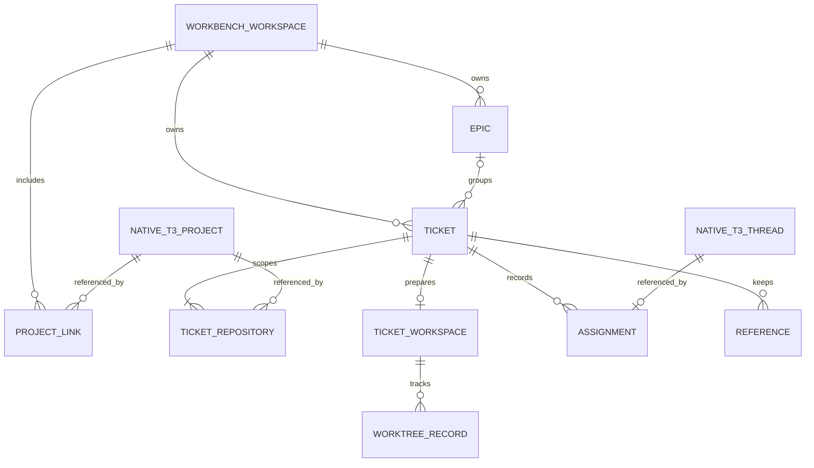

# Workbench data model

Workbench stores planning and delivery records in each T3 server environment's SQLite database. It shares the database with native T3 projections, but owns its own tables and schema migrations. A **Workbench Workspace** is the planning container stored as `workbench_projects`; it is distinct from a native T3 Project. The existing `WorkbenchProject` names in code and storage remain for compatibility. See the [schema initializer](../../packages/workbench/src/WorkbenchSchema.ts) and [native projection schema](../../apps/server/src/persistence/Migrations/005_Projections.ts).

## Relationships

The diagram shows conceptual relationships. Native T3 Project and Thread references are IDs, not SQL foreign keys to their projection tables. The server adapter reads those projections through the same SQL client used by Workbench writes, so store operations can check that referenced records are live. See [WorkbenchNativeAccess](../../apps/server/src/workbench/WorkbenchNativeAccess.ts) and [WorkbenchStore](../../packages/workbench/src/WorkbenchStore.ts).

| Record                                 | Role and constraint                                                                                                                                                         |
| -------------------------------------- | --------------------------------------------------------------------------------------------------------------------------------------------------------------------------- |
| Workbench Workspace and Project link   | A Workspace groups planning records and an ordered set of native repository Projects.                                                                                       |
| Epic and Ticket                        | Both belong to one Workspace. A Ticket can belong to one Epic in that Workspace. An Epic can carry one Jira issue key and URL.                                              |
| Ticket repository and Ticket Workspace | A Ticket has a non-empty ordered repository scope with one primary Project. Its optional Ticket Workspace tracks branch preparation and repository worktrees.               |
| Assignment                             | Links a Ticket to one native Thread. A Thread ID is unique across Assignments; superseded rows retain history.                                                              |
| Thread recap                           | Generated cache keyed by native Thread ID, with no foreign key. Rows outlive unlinked Assignments; snapshots return only recaps of Ticket Threads.                          |
| Reference                              | An ordered, unique URL owned by a Ticket or draft ID. See [References](#references-v22).                                                                                    |
| Thread context                         | What each native Thread was last given of its Ticket or draft, keyed by Thread ID with no foreign key. See [Progress and Thread context](#progress-and-thread-context-v23). |

These constraints come from the [table keys and relationships](../../packages/workbench/src/WorkbenchSchema.ts) and [Ticket scope validation](../../packages/workbench/src/WorkbenchStore.ts). Workbench never reads Jira or any Reference target; a link is only what a user or agent recorded. Tickets imported before v20 keep IDs of the form `jira:<binding>:issue:<id>`; treat them as opaque, because the binding they name no longer exists.

## Ownership and transaction boundary

`packages/workbench` owns the schema initializer, persistence rules, and the `workbench_schema_migrations` ledger. The ledger is separate from native T3 migration numbering. The server supplies the SQLite layer and native Project and Thread reads through an adapter; the Workbench package does not import application code. See [schema initialization](../../packages/workbench/src/WorkbenchSchema.ts), [store composition](../../apps/server/src/workbench/WorkbenchStore.ts), and [server layer](../../apps/server/src/workbench/serverLayer.ts).

Workbench uses SQL transactions for related local changes, such as Ticket and repository rows and Assignment replacement. Native reads within a Workbench transaction use the caller's SQL client and connection, so an ownership check observes the same database boundary as the write. External Git and native Thread creation have separate lifecycles; a SQLite transaction cannot commit them atomically. See [WorkbenchStore](../../packages/workbench/src/WorkbenchStore.ts) and [Ticket Workspace service](../../apps/server/src/workbench/TicketWorkspaceService.ts).

The key application invariants are:

- A Ticket's primary native Project belongs to its Workspace's linked Projects and appears in the Ticket's repository scope.
- An Epic assigned to a Ticket belongs to the same Workspace. Archived Epics cannot receive new Tickets.
- An Assignment references a live native Thread in the Ticket's primary Project when it is created. Historical Assignment rows remain after replacement.

These rules are enforced by [WorkbenchStore](../../packages/workbench/src/WorkbenchStore.ts), rather than by foreign keys to native systems.

## References (v22)

`workbench_references` keeps a Ticket's links, keyed by `(ticket_id, url)` in `position` order. Kind and label are not stored: clients derive them with `parseWorkbenchReferenceUrl` in the [contracts](../../packages/contracts/src/workbench.ts), and its normalized URL is the key, so adding an existing URL is a no-op. `ticket_id` has no foreign key because a draft owns References under its ID before its Ticket row exists; promotion keeps the ID, so nothing is copied. In the write transaction, the store requires the owner to be a non-deleted Ticket or a draft in `creating`, `draft`, or `promoting`. Adding or removing a Reference never bumps the Ticket or draft revision, so an agent's change cannot make a user's open edit stale. Discarding a draft deletes its References with the draft row; a deleted Ticket's References stay with its tombstone and are left out of snapshots. Migration 22 creates the table and copies each Ticket's Jira link, then its Epic's link, into it. It also adds `workbench_tickets.updated_by_thread_id`, the Thread that last changed the title or description, which a user edit clears; a draft keeps the same `updatedByThreadId` in its `payload_json`. Like v20, it alters `workbench_tickets` in place instead of rebuilding it, so the retired Ticket `jira_issue_key` and `jira_issue_url` columns remain, and nothing reads or writes them.

## Progress and Thread context (v23)

Migration 23 adds `workbench_tickets.progress`, a checklist only agents write, and `progress_updated_by_thread_id`. A Progress change bumps the revision but does not touch `updated_by_thread_id` or the generated summary. A draft keeps `progress` at the top of its `payload_json`, outside `fields`, because clients write `fields`; an absent key reads as empty, so older drafts decode. Snapshots carry only `progressDone` and `progressTotal`; the Ticket read carries the list.

`workbench_thread_context` holds, per Thread, the snapshot of its owner it has seen (brief, Progress, References, worktrees, and roster titles), the run that delivered it, the provider conversation, and the native compaction or handoff marker at that time, so a turn can carry only the changes. The runtime policy runs at turn start, at queue time, and at checkpoint rollback, so [TicketContextService](../../apps/server/src/workbench/TicketContextService.ts) writes `workbench_thread_context_pending` only for the Thread's run in `starting`, keyed by run ID; a second, different snapshot for that run marks the row conflicted. Each resolve settles the Thread's pending rows from the native runs projection itself, never from an event consumer, because the next turn can resolve before a consumer catches up. The reads and the settle write share one transaction, so another resolve or the Thread's own edit cannot interleave and leave a stale copy as the record. A clean row of a completed run becomes the record; a slash-command run leaves it. Any other ended run, or a conflicted one, deletes the record: its provider may hold a change the record lacks, and a change can revert (X → Y → X), so an older record is not a safe subset. While another run is in flight, or once the record's own run is no longer `completed` (rolled back), the turn sends everything. A Thread's own reads and writes update both tables, so its own edits are not sent back. Startup drops only the rows of Threads outside a Ticket or draft.

## Jira state removal (v20)

Before v20, Workbench synchronized Jira itself in `workbench_jira_*` tables. Migration 20 in the [schema initializer](../../packages/workbench/src/WorkbenchSchema.ts) folds that state into the `jira_issue_key` and `jira_issue_url` columns on `workbench_tickets` and `workbench_epics`, then drops the Jira tables. Epics still use those columns; v22 retires the Ticket pair. Its [tests](../../packages/workbench/src/WorkbenchSchema.test.ts) cover the upgrade.

- **No table rebuild.** The migration adds the link columns with `ALTER TABLE` and updates rows in place. Rebuilding `workbench_tickets` would cascade-delete its repositories, Assignments, and Ticket Workspaces, and rebuilding `workbench_epics` would clear every Ticket's Epic. The base `CREATE TABLE` statements deliberately omit the link columns, and fresh databases get them from the same migration; adding them to the base statements breaks that `ALTER TABLE`.
- **Legacy DDL stays until migration 20 is recorded.** The Jira `CREATE TABLE` statements run only while the ledger lacks version 20, because earlier numbered migrations still alter those tables. A fresh database creates them and drops them in the same initialization. Do not delete the statements while databases older than v20 can still upgrade.
- **Link precedence.** A Ticket takes its key and URL from an active issue link first, then the most recently seen link, then its creation record. An Epic takes them from its Epic link, then its creation record. Creation records have no URL, so the migration builds `<site>/browse/<key>` from the connection.
- **Inactive links archive the Ticket.** Sync hid Tickets whose issue had left every selected sprint (`MAX(active) = 0`). The migration archives them so they leave the active Board instead of reappearing.
- **Reservations become records.** A Jira creation record whose local Ticket or Epic never appeared, whatever its state, is inserted as a local `todo` record from the stored title and Markdown. Its repository scope comes from the creation request, falling back to the binding defaults. Pending execution runs are settled later by the store's local execution path, not by the migration.
- **Drop order.** Child tables drop before `workbench_jira_bindings` and `workbench_jira_connections`, so no foreign-key action runs during the drop. Stored Jira OAuth secrets are outside SQLite and are not removed.
