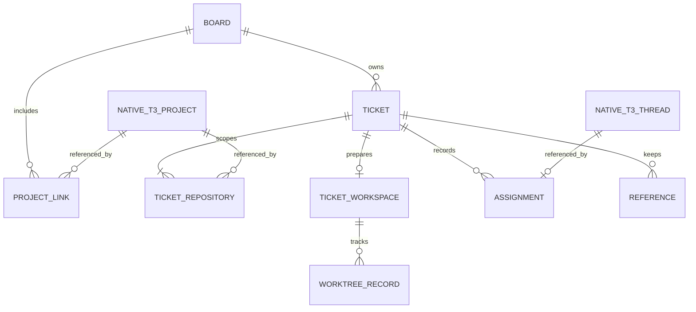

# Workbench data model

Workbench stores planning and delivery records in each T3 server environment's SQLite database. It shares the database with native T3 projections, but owns its own tables and schema migrations. A **Board** is the planning container stored as `workbench_projects`; it is distinct from a native T3 Project. The existing `WorkbenchProject` names in code and storage remain for compatibility. See the [schema initializer](../../packages/workbench/src/WorkbenchSchema.ts) and [native projection schema](../../apps/server/src/persistence/Migrations/005_Projections.ts).

## Relationships

The diagram shows conceptual relationships. Native T3 Project and Thread references are IDs, not SQL foreign keys to their projection tables. The server adapter reads those projections through the same SQL client used by Workbench writes, so store operations can check that referenced records are live. See [WorkbenchNativeAccess](../../apps/server/src/workbench/WorkbenchNativeAccess.ts) and [WorkbenchStore](../../packages/workbench/src/WorkbenchStore.ts).

| Record                                 | Role and constraint                                                                                                                                                                          |
| -------------------------------------- | -------------------------------------------------------------------------------------------------------------------------------------------------------------------------------------------- |
| Board and Project link                 | A Board groups planning records and an ordered set of native repository Projects.                                                                                                            |
| Ticket                                 | Belongs to one Board. Tracker issues are References without lifecycle or parent relationships.                                                                                               |
| Ticket repository and Ticket Workspace | A Ticket has a non-empty ordered repository scope; each of its Threads works in one of those repositories. Its optional Ticket Workspace tracks branch preparation and repository worktrees. |
| Assignment                             | Links a Ticket to one native Thread. A Thread ID is unique across Assignments; superseded rows retain history.                                                                               |
| Thread recap                           | Generated cache keyed by native Thread ID, with no foreign key. Rows outlive unlinked Assignments; snapshots return only recaps of Ticket Threads.                                           |
| Reference                              | An ordered, unique URL owned by a Ticket or draft ID. See [References](#references-v22).                                                                                                     |
| Thread context                         | What each native Thread was last given of its Ticket or draft, keyed by Thread ID with no foreign key. See [Progress and Thread context](#progress-and-thread-context-v23).                  |

These constraints come from the [table keys and relationships](../../packages/workbench/src/WorkbenchSchema.ts) and [Ticket scope validation](../../packages/workbench/src/WorkbenchStore.ts). Workbench never reads Jira or any Reference target; a link is only what a user or agent recorded. Tickets imported before v20 keep IDs of the form `jira:<binding>:issue:<id>`; treat them as opaque, because the binding they name no longer exists.

## Ownership and transaction boundary

`packages/workbench` owns the schema initializer, persistence rules, and the `workbench_schema_migrations` ledger. The ledger is separate from native T3 migration numbering. The server supplies the SQLite layer and native Project and Thread reads through an adapter; the Workbench package does not import application code. See [schema initialization](../../packages/workbench/src/WorkbenchSchema.ts), [store composition](../../apps/server/src/workbench/WorkbenchStore.ts), and [server layer](../../apps/server/src/workbench/serverLayer.ts).

Workbench uses SQL transactions for related local changes, such as Ticket and repository rows and Assignment replacement. Native reads within a Workbench transaction use the caller's SQL client and connection, so an ownership check observes the same database boundary as the write. External Git and native Thread creation have separate lifecycles; a SQLite transaction cannot commit them atomically. See [WorkbenchStore](../../packages/workbench/src/WorkbenchStore.ts) and [Ticket Workspace service](../../apps/server/src/workbench/TicketWorkspaceService.ts).

The key application invariants are:

- A Ticket's repositories belong to its Board's linked Projects.
- An Assignment references a live native Thread whose Project is one of the Ticket's repositories when it is created. Historical Assignment rows remain after replacement.
- A repository cannot leave a Ticket while a current Assignment's unarchived Thread works in it. The check reads native Threads inside the Ticket write, so it covers users and agents alike.

These rules are enforced by [WorkbenchStore](../../packages/workbench/src/WorkbenchStore.ts), rather than by foreign keys to native systems.

A Ticket has no primary repository, but `workbench_tickets.primary_t3_project_id` is `NOT NULL` and stays as a retired anchor, along with `workbench_ticket_workspace_repositories.is_primary`. No contract exposes either. The store fills the anchor with the first repository, keeps it when repositories are reordered, and moves it to the new first repository only when the anchor leaves the Ticket; `is_primary` marks the anchor's checkout and orders checkout rows. Do not give them meaning again: choose a Thread's repository explicitly.

## References (v22)

`workbench_references` keeps a Ticket's links, keyed by `(ticket_id, url)` in `position` order. Kind and label are not stored: clients derive them with `parseWorkbenchReferenceUrl` in the [contracts](../../packages/contracts/src/workbench.ts), and its normalized URL is the key, so adding an existing URL is a no-op. `ticket_id` has no foreign key because a draft owns References under its ID before its Ticket row exists; promotion keeps the ID, so nothing is copied. In the write transaction, the store requires the owner to be a non-deleted Ticket or a draft in `creating`, `draft`, or `promoting`. Adding or removing a Reference never bumps the Ticket or draft revision, so an agent's change cannot make a user's open edit stale. Discarding a draft deletes its References with the draft row; a deleted Ticket's References stay with its tombstone and are left out of snapshots. Migration 22 creates the table and copies each Ticket's Jira link, then its Epic's link, into it. It also adds `workbench_tickets.updated_by_thread_id`, the Thread that last changed the title or description, which a user edit clears; a draft keeps the same `updatedByThreadId` in its `payload_json`. Like v20, it alters `workbench_tickets` in place instead of rebuilding it, so the retired Ticket `jira_issue_key` and `jira_issue_url` columns remain, and nothing reads or writes them.

## Progress and Thread context (v23)

Migration 23 adds `workbench_tickets.progress`, a checklist only agents write, and `progress_updated_by_thread_id`. A Progress change bumps the revision but does not touch `updated_by_thread_id` or the generated summary. A draft keeps `progress` at the top of its `payload_json`, outside `fields`, because clients write `fields`; an absent key reads as empty, so older drafts decode. Snapshots carry only `progressDone` and `progressTotal`; the Ticket read carries the list.

`workbench_thread_context` holds, per Thread, the snapshot of its owner it has seen (brief, Progress, References, worktrees, and roster titles), the run that delivered it, the provider conversation, and the native compaction or handoff marker at that time, so a turn can carry only the changes. The runtime policy runs at turn start, at queue time, and at checkpoint rollback, so [TicketContextService](../../apps/server/src/workbench/TicketContextService.ts) writes `workbench_thread_context_pending` only for the Thread's run in `starting`, keyed by run ID; a second, different snapshot for that run marks the row conflicted. Each resolve settles the Thread's pending rows from the native runs projection itself, never from an event consumer, because the next turn can resolve before a consumer catches up. The text is built without a lock, because every write in the server waits on a transaction. A short transaction then rechecks the Thread's record and pending rows and records the result: if another resolve or the Thread's own edit changed them meanwhile, the turn sends everything and leaves settling to the next resolve, and a run that is no longer `starting` gets no pending row. A clean row of a completed run becomes the record; a slash-command run leaves it. Any other ended run, or a conflicted one, deletes the record: its provider may hold a change the record lacks, and a change can revert (X → Y → X), so an older record is not a safe subset. While another run is in flight, or once the record's own run is no longer `completed` (rolled back), the turn sends everything. A Thread's own reads and writes update both tables, so its own edits are not sent back. Startup drops only the rows of Threads outside a Ticket or draft.

## Review base (v25)

Migration 25 adds `workbench_tickets.review_base_title` and `review_base_markdown`, the title and brief before the first unreviewed agent or Ask for change edit, and `updated_by_ask_for_change`. A draft keeps `reviewBase` and `updatedByAskForChange` in its `payload_json`; absent keys read as no review. Ticket and draft writes name their writer (agent, Ask for change, or user) instead of inferring a user from a missing Thread, and [documentReview](../../packages/workbench/src/documentReview.ts) decides the base. Snapshots carry only `reviewPending`; the Ticket read carries the base. Accept and Undo bump the revision so revision-keyed reads refetch, and Undo records no Thread. Migration 26 adds `accepted_base_title` and `accepted_base_markdown` (a draft's `acceptedBase`): Accept moves the base there so the accepted change can be shown again. Any content change clears it, so it never becomes the next review's base and an Undo cannot revert an accepted change. Snapshots carry only `acceptedChange`; the client reads the base when it is shown. Promoting a draft drops its base, so the new Ticket starts with no review. Ask for change generates outside any transaction and then writes against the revision it read, so a write during generation fails it instead of being overwritten.

Migration 27 adds `workbench_tickets.content_updated_at` (a draft's `contentUpdatedAt`), written with provenance whenever the title or brief changes, so a review can say when its edit happened. It stays NULL for Tickets not changed since. Snapshots carry it because clients show it before reading the base.

## Retired tracker data

Migrations 20, 22, and 24 preserve tracker links as References without rebuilding tables. Migration 24 first copies missing Epic Jira URLs for existing Tickets and drafts into their ordered References, then removes `fields.kind` and `fields.epicId` from its stored JSON. The retired `workbench_epics` table and the Ticket `kind`, `epic_id`, and Jira link columns remain unread by active code. Keep the historical base DDL and migrations: rebuilding these tables can cascade-delete repositories, Assignments, or worktree records. Fresh databases follow the same migration path; new Ticket inserts use the retired columns' existing defaults.

Clients once rendered a Ticket's brief as Jira wiki markup when it had a Jira issue Reference. Migration 27 rewrote those briefs, and their review and accepted bases, to the Markdown they rendered as, with a frozen copy of that converter, and bumped their revisions. No runtime code reads wiki markup; keep that converter frozen with the migration.
