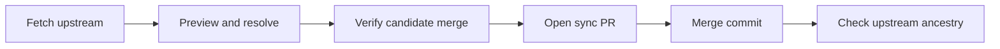

# Maintaining the Agent Workbench fork

The fork keeps T3 Code as the owner of execution and adds Workbench planning in an isolated overlay. Upstream changes enter the product branch through verified merge pull requests. Start with [Workbench architecture](workbench-architecture.md) for module boundaries and request flow, or [Workbench data model](workbench-data-model.md) for storage ownership.

## Upstream first

Staying in sync with upstream T3 Code is a top priority. Each change to an upstream-owned file is a future merge conflict, and each Workbench copy of native behavior stops receiving upstream fixes. Workbench therefore reuses as much of upstream as it can:

1. **Reuse native code.** Use native components, services, and commands through their props, services, and extension points. Workbench composes them and doesn't reimplement them.
2. **Copy only for a real upstream gap, with sign-off.** A Workbench copy of native behavior is allowed only when upstream lacks a capability Workbench needs. Integration effort alone doesn't justify one. Name the missing capability, stop, and get maintainer sign-off before writing the copy. Then record it in the [upstream catalog](workbench-upstream-catalog.md) with that capability as its removal condition. Exceptions already in the catalog aren't precedent for new ones.
3. **Change upstream files last.** Change an upstream-owned file only when no adapter, native extension point, or approved copy can do the job. Keep the change to the smallest integration, record it in the catalog, and mark the site with a short comment that says why it exists and when it can go.
4. **Retire exceptions.** When an upstream sync brings a capability that a catalog entry waits for, switch to it in a follow-up PR and remove the entry.

The goal is for Workbench to become a T3 Code extension once upstream supports extensions. The catalog's "Remove when" column is the list of extension capabilities Workbench needs.

## Isolation boundary

| Source                                    | Ownership rule                                                                                                                               |
| ----------------------------------------- | -------------------------------------------------------------------------------------------------------------------------------------------- |
| `packages/workbench`                      | Own Workbench domain rules, schema, persistence, and Ticket Workspace lifecycle. Do not import applications, including through test helpers. |
| `apps/server/src/workbench`               | Adapt Workbench to native Project and Thread projections, Git, configuration, authorization, and server composition.                         |
| `apps/web/src/workbench`                  | Compose the React Workbench UI. Keep native T3 Threads as the conversation experience.                                                       |
| Workbench modules in `packages/contracts` | Own wire schemas and RPC contracts. Keep shared T3 integrations thin.                                                                        |
| `apps/desktop/src/workbench`              | Own fork distribution policy; do not point Workbench at the upstream updater.                                                                |

Workbench stores references to native `ProjectId` and `ThreadId` values rather than copying T3 records. Its package shares the server process and database with T3, but owns a separate `workbench_schema_migrations` ledger. Server adapters supply native reads and host effects through typed services. Native reads that participate in Workbench writes must use the caller's SQL client and transaction; a separate connection or preloaded snapshot can break writer-lock ordering and ownership checks. [Architecture](workbench-architecture.md) and [data model](workbench-data-model.md) explain the boundary.

Apply [Upstream first](#upstream-first) before changing an upstream-owned file, and preserve behavior outside Workbench. [Ticket lifecycle](workbench-ticket-lifecycle.md) describes the fork-owned behavior that crosses native boundaries.

Native consumers use typed host capabilities with native defaults. Workbench installs its policy at server startup, the web root, and desktop product selection. This is static composition: wire contracts and route declarations retain explicit integration points. Keep Workbench decisions in the installed implementation rather than copying them into native callers.

Server policy installation must reach the layer that constructs native runtime policy; an inner default can otherwise shadow the overlay. Web slots have stable identities, separate from reactive Thread visibility and notification policy. Desktop product selection is synchronous because Electron identity and profile paths are needed during module initialization.

Native capability patches can remain after Workbench imports are isolated. Workbench selects policy through its adapters; native commands retain validation and state transitions that must be serialized together. An adapter precheck cannot replace that boundary. A native decision helper can reduce the integration in the command handler, but its reads must remain inside the same dispatch lock: [Thread repository binding](../../apps/server/src/orchestration-v2/ThreadRepositoryBinding.ts) uses this boundary. Extraction does not remove the fork's native capability patch. Retire a patch only when compatible upstream behavior preserves its callers. Core T3 fixes follow the [upstream ownership rule](../../AGENTS.md#workbench-isolation-and-upstream-sync).

## Package checks

Run the focused checks from the repository root when their scope applies:

```sh
vp run --filter @t3tools/workbench typecheck
vp run --filter @t3tools/workbench test
node scripts/workbench-isolation.ts
vp run workbench:quality
```

The typecheck includes the [package boundary check](../../packages/workbench/check-boundary.mjs). The [quality workflow](../../.github/workflows/workbench-quality.yml) runs the package checks and production quality gates. Tests for native migration integration stay in the server; independent package tests use package-owned fixtures. Read the current scripts and workflow for their exact gates rather than treating this page as a second configuration source.

The [host import check](../../scripts/workbench-isolation.ts) scans tracked and untracked runtime sources using compiler-resolved imports. Its [reviewed integration policy](../../scripts/workbench-isolation-policy.json) permits exact source, target and symbol combinations with a purpose. New dependencies and obsolete allowances fail; wildcard access to the contract barrel also requires review. Run with `--report` to inspect imports and the native diff, or `--report --ref <commit>` for a committed footprint. For a PR, use `--report --base <base-sha> --head <head-sha>`; add `--markdown` for the quality workflow's job summary.

The native diff includes all changed paths outside the fork ownership rules, including tests. PR additions/deletions run from the requested base and head's merge base to head; the report's base SHA and base residuals use that merge base. Residual patch sizes compare against the head's `scripts/workbench-ci-scope.json` baseline, which must be integrated into head. If the merge base predates that baseline, a warning identifies the upstream changes included in its residuals. Renames appear as deletion/addition paths; new paths, growing residuals, fork-added files, and generated lockfiles have separate labels. Binary line counts are unavailable, and report failures produce an unavailable notice. This advisory section enforces no patch-size limit and leaves the import gate unchanged; neither report proves behavior, so retain integration tests and isolation review.

## CI ownership

Keep `.github/workflows/ci.yml` and `thread-transfer-report.yml` identical to the upstream versions integrated into the product. Trust upstream CI for unchanged upstream functionality. [The generator](../../scripts/workbench-ci.ts) owns the fork's `workbench-ci.yml`; it does not copy upstream jobs. [Its ownership policy](../../scripts/workbench-ci-scope.json) maps Workbench sources and exact native integrations to existing tests, application typechecks, builds, or separate Workbench verification lanes. All fork-differing tests with a central runner are included, and an unmapped fork runtime source, rename, or deletion stops CI for review. Workbench native auth, Git/PR, restart, provider-summary, desktop identity, and shared runtime changes remain fork responsibilities even outside Workbench directories.

The policy compares the fork with its pinned integrated upstream commit. During a verified upstream merge, the sync workflow runs `node scripts/workbench-ci.ts --upstream upstream/main` before committing the candidate. This advances the baseline only through the canonical upstream remote, existing upstream ancestry, and an integrated or pending merge; remaining fork differences must still have owners. Regenerate the workflow after changing the policy or generator. Do not advance the baseline to a fork commit or classify a new responsibility as upstream merely to pass CI.

**Workbench feature CI** detects scope on every PR, `main` push, and manual dispatch. Product and tooling changes run focused checks; packaging inputs run shared packaging/version/manifest tests; docs-only changes need scope and the aggregate gate. `Workbench Check` retains its name and fails on scope errors, missing decisions, applicable failures or cancellations, and unexplained skips. Keep Workbench quality, browser regression, demo, preview, and release workflows separate. The fork-generated native transfer-budget reporter is removed: its synthetic upstream traffic does not exercise Workbench, whose persistence and transport integrations have focused coverage.

The inherited **CI** remains manually disabled. This setting lives outside Git; retaining the source preserves upstream ownership, while enabling it would queue unrelated Blacksmith jobs. Keep existing required checks and branch protections intact when changing CI ownership.

Inherited automatic workflows for mobile, the production relay and its PR previews, stale-issue closing, upstream releases, and upstream macOS previews live in [`.github/upstream-workflows`](../../.github/upstream-workflows). GitHub does not discover that directory. Their YAML contents are retained unchanged so Git can carry upstream edits through the renames. `activeWorkflows` in [the ownership policy](../../scripts/workbench-ci-scope.json) is the exact set of files allowed in `.github/workflows`; `node scripts/workbench-ci.ts --check` fails on any other file, so a new or restored upstream workflow stops CI and the sync until it is archived with `git mv` or its triggers are reviewed and allowlisted.

Keep the documented opt-in web preview, manual diagnostic and screenshot tools, and reusable release helpers in the active directory. These do not start unrelated builds on ordinary Workbench pushes. Unchanged mobile, Rust, relay, upstream release trains, and unrelated package suites do not run in routine Workbench CI. Shared dependencies remain exercised through the fork's application typechecks, builds, and mapped integration tests. Restoring an archived workflow requires a separate decision about its triggers, runner, distribution identity, and deployment authority.

## Upstream sync

The fork's `main` in `filipgutica/t3code` is the long-lived product branch. In this clone, `origin` points to the fork and `upstream` to `pingdotgg/t3code`. Preview a sync before merging:

```sh
git fetch upstream main
node scripts/workbench-upstream-sync.ts --product main --upstream upstream/main
```

The preview is read-only. It reports ancestry, files changed on both sides, and merge-tree conflicts. The [sync workflow](../../.github/workflows/workbench-upstream-sync.yml) builds and checks a candidate merge, then opens or updates a PR against the fork's current base. Its write step publishes only the verified two-parent merge commit after checking the exact base and head.

The sync workflow passes its own gates before publishing and does not rely on PR runs. It publishes automatically only when the merge changes no executable CI beyond `inertUpstreamCI`: the manually disabled `ci.yml`, the actions only it uses, and the uncalled `release-desktop.yml` helper. `--check` rejects an active workflow or composite action that reaches those paths, and an inert workflow that could start on its own: it must trigger only on `workflow_call` unless `disabledWorkflows` lists it. Keep that list equal to the workflows disabled in the repository's Actions settings. Any other change under `.github/workflows` or `.github/actions` stops the sync with its paths in the preview, because a published workflow runs with this repository's secrets. Resolve it like a conflict in a reviewed sync PR.

GitHub rejects a `GITHUB_TOKEN` push that adds commits touching workflow files, and upstream history regularly does. The publish job therefore pushes and opens the PR with a token from a dedicated GitHub App installed only on this repository, limited to contents, pull requests, and workflows. Its client ID is the `WORKBENCH_SYNC_APP_CLIENT_ID` variable and its private key the `WORKBENCH_SYNC_APP_PRIVATE_KEY` secret of the `workbench-upstream-sync` environment, which accepts only `main`. App pushes start the normal push workflows; the dispatch job still runs Workbench feature CI and quality for the published merge SHA when no exact-SHA run exists. If main moves before dispatch, those gates fail rather than verify a different checkpoint. Daily releases accept successful push or dispatch runs only for the exact main SHA.



Merge an upstream-sync PR with **Create a merge commit** or `gh pr merge --merge`. Squash and rebase discard upstream ancestry and make later syncs revisit already-integrated changes. After merging, use the exact upstream SHA recorded by that sync:

```sh
git fetch origin main
git merge-base --is-ancestor "$SYNCED_UPSTREAM_SHA" origin/main
```

Exit code zero confirms that the recorded upstream commit is an ancestor of the product branch. Do not substitute the latest `upstream/main`, which may have advanced. Accept a sync only after resolving every non-generated conflict and checking Workbench contracts, store, authorization, relevant UI behavior, application typechecks, and the desktop smoke test. The [sync workflow](../../.github/workflows/workbench-upstream-sync.yml) owns the current gate list. Treat any new edit outside Workbench-owned directories as an ongoing upstream maintenance cost.

Release the fork from its `main` through a separate fork-owned distribution channel. Upstream releases do not contain the Workbench overlay.
