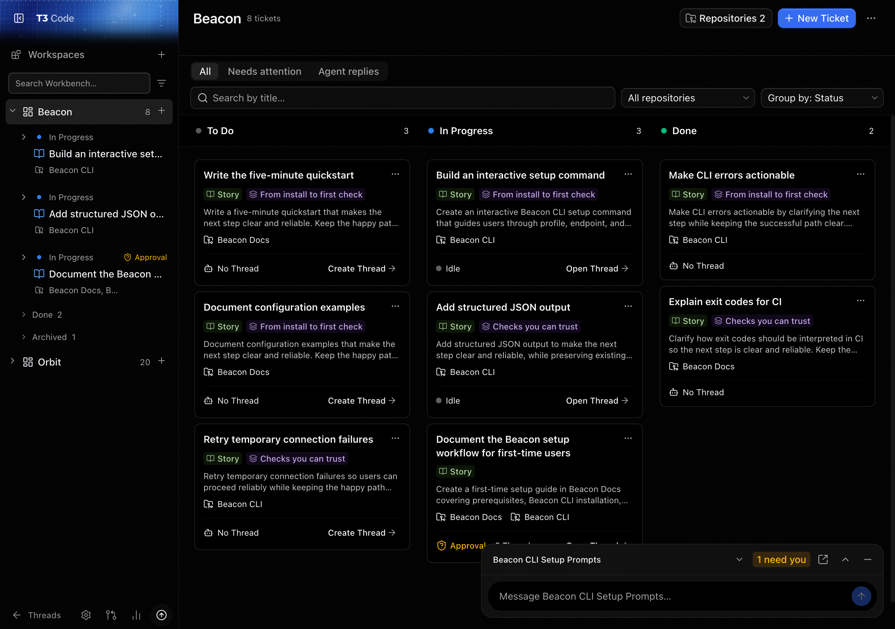
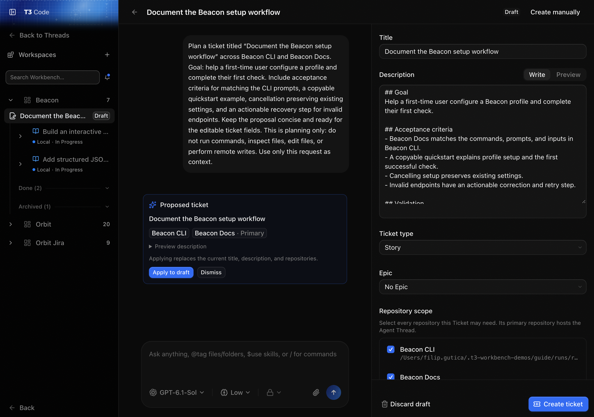
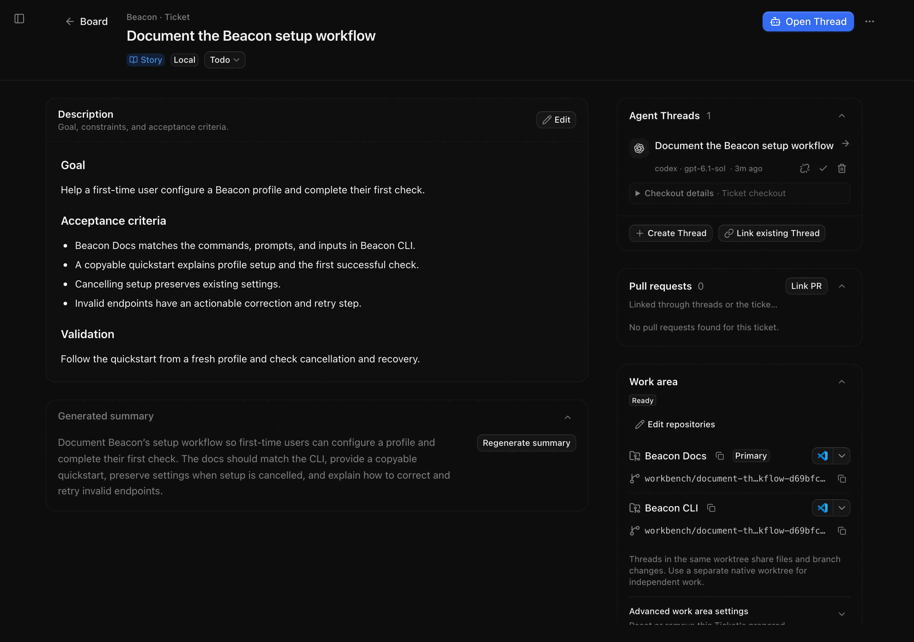
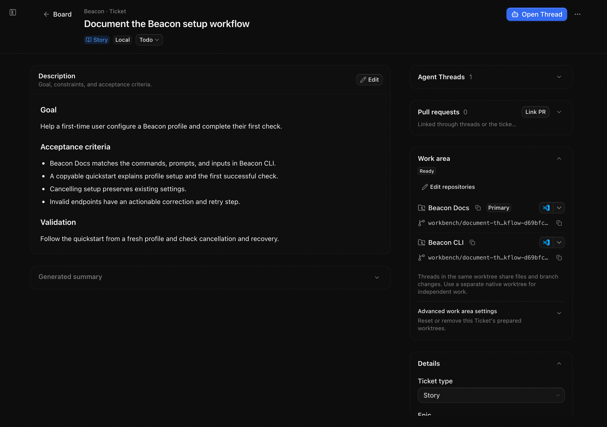
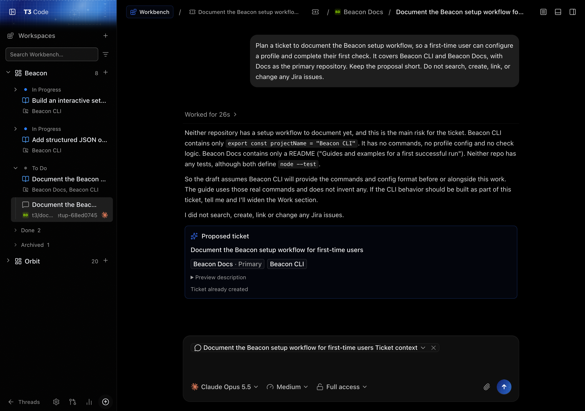
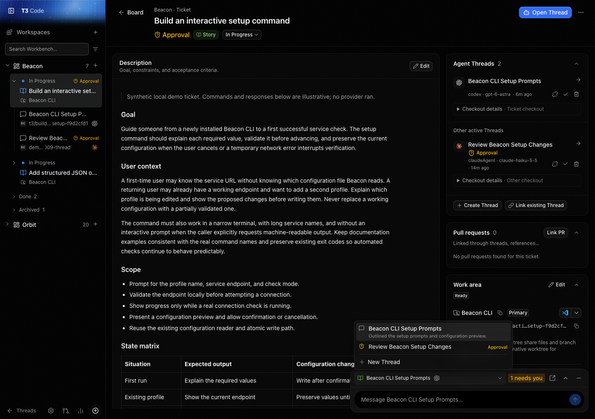
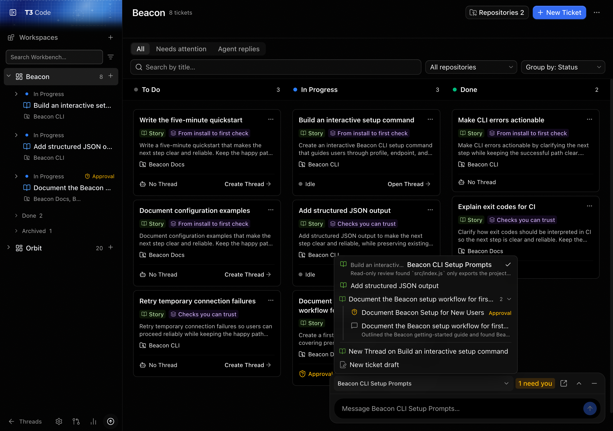
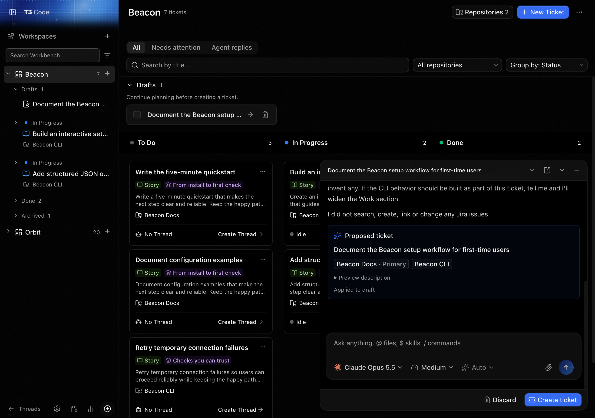
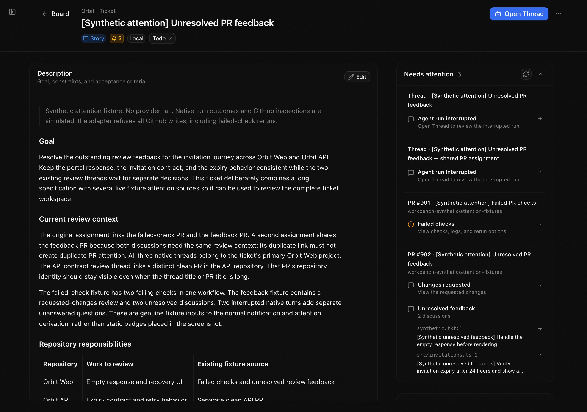
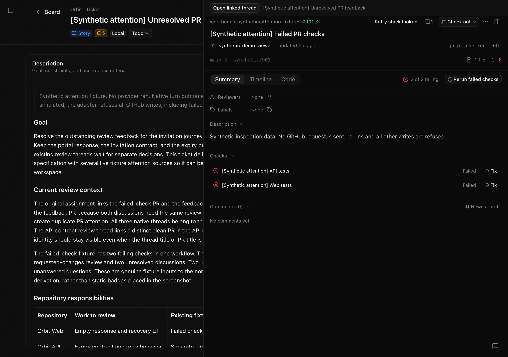

# Workbench user guide

Workbench gives you one view of work across repositories: what’s to do, in progress,
and done. Each Ticket brings together its context, agents, pull requests, and an
isolated work area with worktrees for the repositories involved.

Workbench is available in the web and desktop clients. Each T3 environment has its
own Workspaces and Tickets, so records do not appear across environments. There is
no dedicated Workbench mobile interface yet.

<picture>
  <source media="(prefers-color-scheme: light)" srcset="./media/workbench/board-light.png">
  
</picture>

The screenshots use fictional Orbit and Beacon projects in an isolated demo.
Planning conversations and prepared Git worktrees are real. Recaps, approval requests,
PR feedback, and implementation outcomes are illustrative; they do not show completed product work.

For a visual tour from plan to merged pull request, open the [Workbench site](https://filipgutica.github.io/t3code/).

## Create a Workspace and Ticket

A **Workbench workspace** groups T3 Projects that belong together. Linked Projects
must point to Git repositories. A **Ticket** describes work to do; an **Epic** groups
related Tickets. A Ticket's **work area** contains its prepared repository worktrees.

1. Add the repositories you need as T3 Projects.
2. Open **Agent Workbench**, choose **Add Workspace**, select the Projects, and
   choose **Create Workspace**.
3. Open the Workspace Board and choose **New Ticket**.
4. Describe what you want to work on in the planning conversation. Choose your
   model using the native conversation controls.
5. As you talk, the agent fills in the draft's title, description, and
   repositories, and adds links you paste as [References](#references). You can edit
   the title, description, and repository selection. Ask the agent to change Progress.
6. Choose **Create ticket** to save it.

<picture>
  <source media="(prefers-color-scheme: light)" srcset="./media/workbench/planning-light.png">
  
</picture>

You do not need a title or repository selection before starting the conversation.
Planning can read the workspace's repositories, run commands, and write notes
outside them, but it is told not to change them or start implementing. Ask
follow-up questions to refine the draft. The agent's edits apply at once, and you
can change editable fields back; see [Agents and the Ticket](#agents-and-the-ticket).
Filling the draft does not create the Ticket.

Planning can use your configured connectors, web tools, the browser, and CLI tools
such as `gh` for research. Ask it to find or create Jira or GitHub issues with its
own connectors, and it records them as References. Planning runs in Auto, so the
provider's automatic reviewer handles approval requests instead of you.

Leaving the view keeps the draft in the Board’s **Drafts** section and the Workbench
sidebar. Open it to resume its conversation and saved fields. Choose **New Ticket**
to explore another idea in a separate draft. Planning conversations stay in
Workbench until you start work.

**Create manually** opens the form when you already know the requirements. To plan
without leaving the Board, start a draft from its chat; see [Chat with Threads](#chat-with-threads).

Creating the Ticket keeps the same conversation for further planning. Choose
**Start work** when ready to prepare its work area and continue that Thread in the
primary worktree. Start work does not send a message; send your next instruction
to begin implementation. Planning supports Codex and Claude providers.

The primary repository is where new Threads open. A Ticket can include other
repositories when the work spans several codebases. Use **Edit Workspace** to
rename a Workspace or add repositories; existing Tickets and Threads
keep their scope.

<picture>
  <source media="(prefers-color-scheme: light)" srcset="./media/workbench/ticket-light.png">
  
</picture>

## Archive or delete a Workspace

Choose **Archive Workspace** from the Workspace actions menu to hide it from the
active list and attention counts. Open **Archived Workspaces** in the sidebar to
inspect its Tickets and Epics. Archived planning is read-only, and linked native
Threads remain available. Choose **Restore Workspace** to resume planning.
Restoration keeps individual Ticket and Epic archive states.

Choose **Delete Workspace** from the same menu and review the Ticket and Epic
counts before confirming. Deletion permanently removes the Workspace's planning
data from Workbench. Native Projects, Threads, Git worktrees, branches, commits,
and linked Jira issues remain. There is no undo. **Retained worktrees**
in the sidebar remains available for cleanup even after deleting the last Workspace.

## Start agent work

For a Ticket prepared through a conversation, choose **Start work** to continue
that same Thread in its prepared work area. Add your next instruction and send
when ready.

For a manually created Ticket, or an additional conversation:

1. Open a Ticket and choose **Create Thread**.
2. If the work area is not prepared, review the primary and additional repositories.
   Select a provider and model, then choose **Create work area and Thread**.
   Prepared work areas show the repositories that the new Thread will reuse.
3. Add instructions and send the message.

Creating a Thread does not start an agent turn. Workbench prepares one Git
worktree per selected repository and opens the Thread in the primary repository's
worktree.

Each Thread receives the full Ticket on its first turn: the brief, Progress,
References, prepared worktrees, and other linked Threads. Later turns receive only
changes. After compaction, a handoff, or a provider conversation change, the Thread
receives the full context again.

Expand **Shared context** on the Ticket to read what a new Thread would receive.
If it is stale or incomplete, update the brief or References, or ask the agent to
change Progress. Saved changes reach other Threads on their next turn.

To prepare worktrees before opening a conversation, choose **Prepare work area**
in **Work area**, review the repositories, and confirm.

<picture>
  <source media="(prefers-color-scheme: light)" srcset="./media/workbench/workspace-light.png">
  
</picture>

<picture>
  <source media="(prefers-color-scheme: light)" srcset="./media/workbench/thread-light.png">
  
</picture>

Use **Create Thread** for another conversation on the same Ticket. Use **Link existing
Thread** to add an unassigned native conversation, or **Unlink Thread from Ticket**
to remove the association without deleting it. **Settle** moves a conversation out
of the active group; **Thread history** keeps earlier conversations available.

Opening a Thread from a Ticket keeps the Workbench context visible. Use the Board
or Ticket links to return to the work, or choose **Back to Threads** to restore the
regular T3 sidebar. The command palette also offers **Open Workbench**, **New
Ticket** for the current Workspace, and **Back to Ticket** from a linked Thread.

The Workbench sidebar lists Tickets. Reach a Ticket's Threads from its page or its
chat, which list Threads that need attention first.

## Chat with Threads

The Board and each Ticket have a chat in the lower-right corner. The board chat
lists the Threads of the Workspace's Tickets and drafts. The ticket chat lists that
Ticket's Threads. Use it to follow and answer agents without leaving the page.

- Select the open Thread's name to switch Threads, search them, or find settled and
  archived ones.
- After a Thread finishes a run, the menu can show a short recap of it. Threads on
  the same Ticket read each other's recaps so they know what the others are doing.
- When other Threads wait for your approval or input, or their run failed, **N need
  you** opens the menu on the first of them.
- Select the message field to expand the conversation, or choose **Show chat** in
  the command palette. Drag the chat's left edge, top edge, or top-left corner to
  resize it.

<picture>
  <source media="(prefers-color-scheme: light)" srcset="./media/workbench/ticket-chat-light.png">
  
</picture>

New-Thread actions end the Thread menu. In the ticket chat, **New Thread** starts
another Thread on the Ticket, and it opens in the chat. In the board chat, **New
Thread on** starts one on the open Thread's Ticket, and **New ticket draft** starts
a planning conversation.

<picture>
  <source media="(prefers-color-scheme: light)" srcset="./media/workbench/board-chat-light.png">
  
</picture>

A board draft plans the same way as **New Ticket** and runs in Auto. When the
agent has filled in the draft, choose **Create ticket** and **Start work**; the same
Thread continues throughout. **Cancel** removes a draft you have not used yet and returns to the Thread
you had open. Once you have used the draft, **Discard** removes it after you confirm. The draft stays pinned above
the conversation. Edit its title there, or choose **Show full brief** to read the
brief and Progress and edit the other fields. In a short window it starts
collapsed to one row.

<picture>
  <source media="(prefers-color-scheme: light)" srcset="./media/workbench/board-draft-light.png">
  
</picture>

Files, diffs, side chats, and pull requests you open from the chat open in the
Thread's side panel beside it, and you stay on the page. While the chat shows a
Thread, pull requests you open on the page open there too. Maximize the panel to
fill the page; the chat stays over it. In a smaller window the panel opens as a
sheet and the chat minimizes until you close it. The details button in the chat
header shows the Thread's details, as on a Thread page. Terminal commands and
**Open full Thread** open the Thread itself. The chat is not available on narrow
screens, and a Ticket that is still being planned shows its conversation in the
page instead.

## Follow progress and review results

**Progress** is the agent-maintained checklist of planned work. Ask the agent to
write it, change the plan, or mark completed items. It is read-only in the draft
and Ticket; the Board shows its completed and total counts. Completing the
checklist does not mark the Ticket Done.

Ticket status and agent activity describe different states:

| Ticket status            | Agent activity                    |
| ------------------------ | --------------------------------- |
| To Do, In Progress, Done | Working, Waiting, Approval, Input |

Thread activity uses the same status as native Threads, including elapsed time
while working. A Ticket summarizes its current linked Threads: approval requests,
input requests, and failures take priority over work in progress. Notifications
and **Needs attention** remain available separately for reviewing results.

When a linked Thread starts a turn, a To Do Ticket moves to In Progress. **A
completed agent turn does not mark the Ticket Done.** Review the result, then set
the Ticket status from the Ticket or Board card menu when the work is accepted.

Use **Needs attention** on the Board, or in the sidebar's filter menu, to find
approval and input requests, failed runs, failed PR checks, PR feedback, plans
ready for review, finished agent turns, and approved PRs. The sidebar filter
sorts the most urgent work first. **Agent replies** narrows the Board to
completed agent work awaiting review. PR inspection covers explicitly linked PRs; the Board shows
incomplete or unavailable coverage and lets you refresh.

Each Ticket and Thread shows its most urgent reason in the status area, with
**+N** for other reasons. Click it to see the reasons grouped by Thread and PR.
Thread reasons open the Thread; failed checks, requested changes, and unresolved
discussions open the PR. **Approved** means the PR is approved, has no
failing or pending checks, and has no merge conflicts; the host can still block
the merge on other rules, such as a required check that was cancelled. The
Ticket page keeps these actions in its **Needs attention** section. Opening the
list does not clear them.

Opening a Thread acknowledges its notification. A pending question or approval
stays until you respond, and an interrupted run is not a reason. PR actions
remain until the checks or review feedback are resolved, and **Approved** stays
while those conditions hold and the PR is open. A review thread stops counting once you reply
to it, and counts again when someone else comments. Resolving
it on the host clears it for good.

<picture>
  <source media="(prefers-color-scheme: light)" srcset="./media/workbench/notifications-light.png">
  
</picture>

The Ticket's **Pull Requests** section collects PRs reported by linked Threads and
prepared worktrees, and the Ticket's pull request
[References](#references). PRs opened to deliver the Ticket belong in its linked
Threads. Keep prior or example PRs as supporting References; do not add delivery
PRs there too. To attach a delivery PR yourself, choose **Link PR** from
the Ticket, select a Thread if prompted, then choose a listed PR or search by
title. You can paste a full PR URL when browsing is unavailable or the PR is not
listed. A number such as `#42` refers to the selected Thread's repository. Link PR
needs a live assigned Thread and a project with a supported Git remote in the same
environment. You can also use **Link pull request to thread** in the native
Thread's command palette.

<picture>
  <source media="(prefers-color-scheme: light)" srcset="./media/workbench/pull-request-light.png">
  
</picture>

## Edit and organize Tickets

Use Board search to find loaded Tickets by title or by a Reference's label or
title, such as an issue key. Filter by any
repository in their scope. Search, repository filtering, grouping, and the
selected Board column are retained per Workspace when returning from a Ticket.
Open a Ticket and choose **Edit** to change its title or description. Saved
descriptions display formatting. Board previews use a separate summary generated
from **Settings → General → Text generation model**. Regenerate it from the Ticket
menu when needed; the summary does not replace the full description sent to the
agent.

Choose **New Epic** from the Workspace actions menu, assign related Tickets, and
set the Board's **Group by** to **Epic** to show Epic swimlanes. On desktop, drag
Tickets between status columns.

Archive a Ticket to hide it from the active Board, or restore it from
**Archived**. Deleting a Ticket removes it from Workbench but keeps its native
Threads and repository worktrees.

## Manage repositories and worktrees

Choose **Edit** in **Work area** to change the Ticket's repositories. Use **Add
repository** to add one, and a repository's **⋯** menu to make it primary or
remove it. Changes stay marked as Adding or Removing until you choose **Save
changes**; **Cancel** restores the saved choices. Adding repositories to a
prepared work area prepares their worktrees together after saving. **Create
Thread** can change any repository while the Ticket has no prepared worktrees.
After preparation, it can only add repositories; change the primary or remove a
prepared repository in **Work area**.

Threads using the same Ticket worktree share its files, branch, and uncommitted
changes. Existing Threads keep their working directory and sent context when the
Ticket's repository scope changes. Adding a repository to an already prepared
work area prepares its worktree; removing one keeps its worktree and local
changes so it can be added again later.

Creating a Workspace groups existing Projects; it does not create repository
directories. **Prepare work area** creates worktrees without opening a Thread, and
**Create Thread** prepares missing worktrees and reuses existing ones. Creating or
viewing a Ticket alone does not prepare worktrees.

To remove prepared worktrees, delete Threads that still use them, including archived
Threads. Unlink Threads working elsewhere. Commit or preserve local changes, then open **Ticket
work area → Advanced work area settings → Remove prepared worktrees** and confirm.
The reset removes worktrees but keeps the Ticket, branches, and commits.

After deleting a Ticket or Workspace, open **Retained worktrees** in the Workbench sidebar to
remove its kept worktrees. Review the listed repository paths, choose **Remove**,
and confirm. The same Thread ownership and local-change checks apply.

## References

References are current sources that a Thread should read: requirements, plans,
specs, designs, issues, docs, and prior or example pull requests. Remove a Reference
when its file is superseded. Ask the agent to retitle one when its status changes,
such as from proposed to approved. Keep audit output, test results, and evidence
logs in the artifacts folder or PR.

Link PRs opened to deliver this Ticket through a Thread; do not duplicate them as References.
Workbench shows these sources but does not connect to Jira or open the linked pages itself.

To add one, choose **Add reference** in the Ticket's **References** section and
paste a URL or an absolute file path, with an optional title. Drafts and the
manual Ticket form have a paste field for References, which are saved with the
Ticket. Use a Reference's remove button to remove it.

Issue References show their key or repository and number, such as `PROJ-123` or
`orbit-web#12`. Board cards show up to two, and Board and sidebar search match
them. The first issue Reference also names the branch when the work area is
prepared, so add it before you prepare.

Pull request References appear in **Pull Requests** instead of **References**,
together with the PRs that linked Threads report. **Unlink** on such a row removes
only the Reference; a PR that a Thread also links stays listed. **Needs
attention** covers only PRs linked to a Thread.

A file Reference is a path on the machine that runs the environment. It opens in
the file viewer from any connected client, including remote ones. A file that no
longer exists shows as unavailable.

Epics keep a single Jira link. Open the Epic's details and choose **Link issue**
under **Jira issue** to paste the issue's URL, or **Change** or **Unlink** to
replace or remove it.

Tickets that had a Jira link in an earlier version keep it, and their Epic's
link, as References. Workspaces that synced with Jira in an earlier version keep
their Tickets and Epics as ordinary records. Workbench no longer updates them
from Jira; edit, move, archive, or delete them like any other record. Tickets
whose issues had left the selected sprints are archived. If an earlier version
could not confirm that it created a Jira issue, the Ticket or Epic stays a local
record, linked only if its issue key was known. Check Jira and add the issue
yourself if needed.

## Agents and the Ticket

Planning Threads and Threads on a Ticket can read and change their own Ticket or
draft while they work. An agent can change the title, description, repository
scope, and Progress. It can also add, remove, or retitle References. Its changes
apply at once and show in the Thread. It cannot remove a repository that an active Thread works in.

A description an agent changed shows **Updated by** and the Thread's name until
you edit it. A Reference an agent added shows **Added by**. Edit those fields as
usual, or ask the agent to revise Progress.

Agents record References on their own. When you paste supporting links into a planning
conversation, or an agent finds a related issue or prior example, it adds them.
Agents link PRs they create, take over, or push to through their Thread instead of
also adding them as References. Agents use their
own connectors, such as Jira or GitHub, when you ask.

Agents use `workbench_ticket_read` to read the current Ticket or draft and
`workbench_ticket_update` to revise it, including Progress. They use
`workbench_reference_update` to retitle an existing Reference without removing it.

Each Ticket has an artifacts folder on the machine that runs the environment,
under `userdata/workbench-artifacts` in the T3 data directory. Agents save plans,
specs, mockups, and diagrams there and add current sources as References. Deleting the
Ticket or discarding the draft keeps the folder.

## Troubleshooting

| Problem                                           | What to check                                                                          |
| ------------------------------------------------- | -------------------------------------------------------------------------------------- |
| The agent has not started after creating a Thread | Send a message; creation only prepares the conversation.                               |
| A completed turn leaves the Ticket In Progress    | Review the result and set the Ticket status to Done.                                   |
| A repository is missing from a Workspace          | Add its directory as a T3 Project first.                                               |
| A prepared worktree is missing                    | Remove Threads that use it, reset the Ticket work area, then prepare again.            |
| The agent cannot find or create Jira issues       | Set up a Jira connector for that provider; Workbench does not connect to Jira itself.  |
| Workspaces or Tickets seem to be missing          | Check the connected environment; each environment has separate records and saved data. |

For connecting another device, see [Remote access](./remote-access.md).
